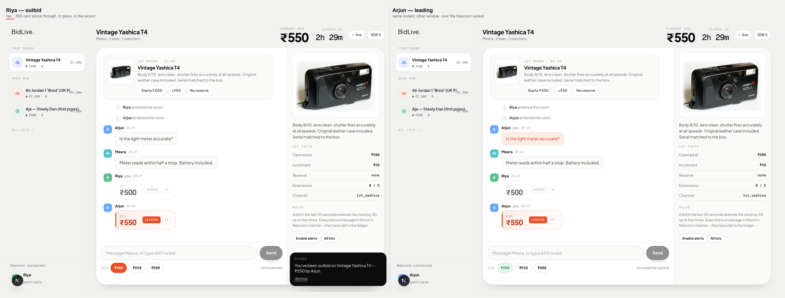

# BidLive

**A live auction that runs inside a chat room.** Bids are messages. The clock is enforced on the
server. Every raise stays in the room's history forever, so a dispute has a transcript instead of a
he-said-she-said.

Built for the **Nexconn Build Challenge 2026**.

---



## Run it

```bash
npm install
cp .env.example .env.local   # optional — it works without credentials
npm run dev                  # http://localhost:3000
```

It runs end-to-end with **no credentials at all**: the auction uses a local event bus and the UI
honestly reports `Nexconn: local bus`. Add credentials and the same room is backed by Nexconn.

### The two screens

| Route | What it is |
|---|---|
| `/` | The landing page — what this is, and a live lot you can bid on without signing up |
| `/app` | The app: every lot, your rooms first, the first lot featured |
| `/app/[lot]` | A room — the auction, with a **persistent rail** listing every auction you are in |

The rail is the reason there are not five browser tabs: it stays put while the lot in the middle
changes, and each row carries its own live countdown.

### Try the demo in 60 seconds

1. Open <http://localhost:3000/app/yashica?as=Riya> — you're Riya, bidding.
2. Open <http://localhost:3000/app/yashica?as=Arjun> in a second window — you're Arjun.
3. Bid in one window; watch the other flip to `LEADING` / `OUTBID`.
4. Enter a second lot and switch between them in the rail — both countdowns keep running.
5. Open <http://localhost:3000/app/yashica?as=Meera> — Meera is the seller, so you get the
   auctioneer controls: **+60s**, **Close in 30s**, and a mute list.

`?as=Name` is a demo shortcut; it just sets the same identity the gate would. Old `/lot/x` links
redirect into the app, so the rehearsal scripts and any shared links still work.

### Design

A neutral product surface rather than a themed dashboard: light grey ground, white cards, a heavy
geometric sans (Plus Jakarta Sans) for display and Geist Mono for anything that ticks. One accent —
an auction orange — is reserved for live state and the primary bid action, so colour means something.

Two details worth calling out:

- **Real photography.** Every lot carries an actual photograph (Wikimedia Commons; see
  `public/images/lots/CREDITS.json`). Product shots are `object-fit: contain` on white so nothing is
  ever cropped mid-object, which is the usual failure of card grids built on stock images.
- **Hand-drawn icons.** `components/ui/LotIcon.tsx` is a small icon family on a 24px grid at one
  stroke weight — camera, sneaker, vinyl, watch, tag. The rail tints each lot's tile by category
  instead of showing an emoji, so the sidebar reads as a designed list rather than a chat log.

Fonts are self-hosted in `public/fonts` (no build-time network call, no Google Fonts dependency).

## Why chat, not a bid button

Auctions are social: the condition question, the provenance photo, the "going once…" call. A
separate bidding form splits the audience from the conversation and turns a live event into a form.
Here the composer is dual-purpose — type text and you're chatting, type a number at or above the
minimum and the send button becomes the bid.

The second reason is durability. An auction is a dispute machine. Every bid is a message in a Nexconn
group channel: ordered, offline-safe, retained, searchable months later. **The transcript is the
ledger.**

---

## Architecture

```
browser ──────────────► Next.js route handlers ──────────────► Nexconn Server API
   │  (SSE: fast path)          │  (single writer)              (GroupChannel per lot)
   │                            │
   │                            ├─ lib/auction.ts   pure rules: min increment, anti-snipe,
   │                            │                   settlement, recall recomputation
   │                            ├─ lib/store.ts     lots + append-only event log + subscribers
   │                            └─ lib/service.ts   placeBid / recall / chat / moderate / settle
   │
   └── Chat SDK (@nexconn/chat) ── connect, join channel, receive ──► same channel
```

**The server is the only writer.** That single decision removes the whole class of bugs where two
clients disagree about who is winning:

- **Ordering** — every accepted bid gets a monotonic `seq` from the event log. Clients render by
  `seq`, never by arrival time. Two bids in the same millisecond resolve deterministically.
- **The clock** — `endsAt` lives on the server. Clients receive `serverTime` with every push and
  correct their own offset, so a device with the wrong time still sees the truth.
- **Anti-snipe** — a bid inside the final 30s extends the lot by 30s, capped at five extensions. The
  extension is *broadcast as a message*, not a silent number change.
- **Settlement** — lazy close: any read after `endsAt` settles the lot, so it works on a platform
  with no long-running timers.
- **Recomputation** — a lot's leader is derivable from its event log alone (`recomputeTop`). Recall a
  bid and the leader recalculates from the transcript, not from a mutable counter.

### The rules, in one place

`lib/auction.ts` is pure functions with no I/O. The same `validateBid` is used by:

1. `POST /api/lots/[id]/action` — the live path.
2. `POST /api/nexconn/callback` — the pre-delivery callback path (see below).

Two entry points, one rule set, so they cannot drift.

---

## Where the data lives (there is no database)

On purpose. Two layers, both Nexconn:

| Layer | What it holds | Lifetime |
|---|---|---|
| **Process memory** (`lib/store.ts`) | the live projection: lots, current top bid, sequence, watchers, mute list | until restart — it is a cache, not the record |
| **Nexconn channel per lot** | every bid, chat and settlement as a custom message | 180 days |

On a cold start the projection is empty, so the room **replays itself out of the
transcript**. The browser is the component holding an authenticated chat session, so it
reads the channel history through the SDK and posts it to `/api/lots/[id]/rehydrate`;
the server replays those messages through the same rules that accepted them:

- bids are re-checked (right lot, right sender, integer amount, seller excluded);
- sequence numbers are **re-issued** in chronological order, because the original
  numbers were per-process and restart with the server;
- a channel accumulates every demo run, so replay finds the start of the current
  round — the last settlement, or the first bid that breaks the rule that every
  accepted bid must be higher than the one before it;
- anything that could not have been produced by the live rules is dropped.

That last point is the trust boundary: a client may hand the server a transcript, but it
cannot hand it a fiction the auction engine would have refused. The client still never
publishes a bid directly.

`/api/dev/reset` deliberately disables replay for the rest of the session — otherwise a
reset would immediately re-import the bids it just cleared.

## Nexconn integration

| Capability | How it's used | Where |
|---|---|---|
| **Group channel per lot** | The room's durable message log | `lib/nexconn/server.ts` |
| **Custom messages** (`bidlive:Bid`, `bidlive:System`, `bidlive:Chat`) | Bid cards, extensions, settlements as structured messages | `lib/service.ts` |
| **Server API + App Secret** | Token issuance and message publication, server-side only | `app/api/token/route.ts` |
| **Chat SDK (web)** | Client connects, joins the channel, tracks connection state, receives over the socket | `lib/client/nexconn.ts` |
| **Push** | Outbid and settlement notices; the room also raises a browser notification | `lib/service.ts` → `notifyUser` |
| **Moderation** | Mute list that visibly refuses a muted bidder's bids | `moderate()` |
| **Pre-message callback** | Optional pre-delivery validation — a rejected bid never reaches the room | `app/api/nexconn/callback/route.ts` |
| **Presence / read state / 180-day history** | Inherited by using a real channel instead of a bespoke socket | — |

### Enabling the real thing

```bash
NEXCONN_APP_KEY=...               # console.nexconn.ai → App Key page
NEXCONN_APP_SECRET=...            # same environment as the key
NEXT_PUBLIC_NEXCONN_APP_KEY=...   # same App Key; safe to expose
NEXCONN_API_BASE=https://api.sg-light-api.com   # Singapore data centre
NEXCONN_AREA_CODE=2
```

Run **`npm run check:nexconn`** first. It authenticates against every regional
host and prints the exact `NEXCONN_API_BASE` / `NEXCONN_AREA_CODE` your app needs —
the wrong data centre looks identical to a broken SDK, and that confusion costs
hours. Then restart the dev server: `NEXT_PUBLIC_*` is inlined at build time.

Then the top bar reads `Nexconn live`, and the room shows `SDK · n` — `n` counts messages actually
received over the Nexconn socket, so the pill is evidence rather than decoration.

For **pre-delivery** validation (the strongest version: an invalid bid never exists for anyone),
point a message callback at `/api/nexconn/callback` in the console and set
`NEXCONN_CALLBACK_ENFORCE=1`. The endpoint blocks with `code: 4` and the rejection reason.

**Which data centre?** Nexconn runs one per region, and an app only exists in its
own. This app authenticated on **North America** (`api.us-light-api.com`,
areaCode 3) — if we had assumed the Singapore default, every call would have
returned `403 App-Key is not exist` and looked like a broken SDK. `npm run
check:nexconn` is what turned that into a one-line fix.

The App Secret is never sent to the browser. `app/api/token/route.ts` is the only place that touches
it, and it only ever returns a user token.

---

## Verified against live credentials

Run with a real Production App Key on the North America data centre:

| Check | Result |
|---|---|
| `npm run check:nexconn` — region + signature | ✅ authenticated on `api.us-light-api.com` |
| `GET /api/token` — Server API user registration | ✅ real token issued |
| Group channel create + join (owned by the auctioneer bot) | ✅ |
| `bidlive:Bid` publish per bid | ✅ |
| `bidlive:Chat` publish per message | ✅ |
| `bidlive:System` publish on settlement | ✅ |
| `/message/private/publish.json` outbid notice | ✅ |
| **Chat SDK connects in the browser** (init + area code + token + join) | ✅ pill reads `SDK · n` |
| **Live receive** — counter rises when a message arrives | ✅ `SDK · 1` → `SDK · 2` (`node scripts/verify-sdk.mjs`) |

## What works today

- [x] Landing page with a live lot, real countdown and working bid links
- [x] Persistent rail: switch between every auction you are in, each with its own timer
- [x] Overview: featured lot, "in room" markers, per-lot countdowns
- [x] Lot room with bid cards, `LEADING` / `OUTBID` / `WON` states rendered in place
- [x] Server-authoritative bidding: minimum increment, banded increments, rate limit
- [x] Anti-snipe extension, capped, announced as a message
- [x] Recall a bid → lead recomputed from the event log
- [x] Settlement with winner, final price, bid count; unsold when the reserve isn't met
- [x] Auctioneer controls: extend, close in 30s, mute/unmute a bidder
- [x] Outbid + settlement notices, in-app and as browser notifications
- [x] SSE fast path with reconnect, gap detection and resync
- [x] Mobile layout that leads with price, clock and bid box
- [x] Cold start replays the auction out of the Nexconn transcript (no database)
- [x] Degrades to a local bus with an honest badge when credentials are absent

## Deliberately out of scope

Payments, authentication beyond a display name, multi-tenant auction houses, and image uploads. Each
would have cost a day and none of them makes the auction mechanic more convincing.

---

## Recording the demo

```bash
npm run record      # needs ffmpeg on PATH (brew install ffmpeg)
```

It drives two real browser windows — Riya bidding, Arjun counter-bidding — with real clicks,
records both, and composites them side by side with a title and end card:

```
docs/video/bidlive-demo.mp4   2560×720 · ~35s · silent
```

The beat list is deliberately sparse: a question, three taps, then the auctioneer closes the
lot with 14 seconds left so the countdown visibly runs down in red, a bid lands, and the clock
jumps to ~0:36 with the extension message. That one moment is the whole anti-snipe argument,
so it gets the most screen time.

The capture is silent. Two ways to finish it:

- **Narrate over it** — drop the mp4 into iMovie/CapCut, record a voiceover against the shot
  list in [`docs/SUBMISSION.md`](docs/SUBMISSION.md), export 1080p.
- **Record it yourself** — `Cmd+Shift+5` on macOS (or Screen Studio for the polished cursor
  smoothing), two windows side by side, following the same beats. Best if you want your own
  cursor and voice in one take.

Either way: `POST /api/dev/reset` first (or the footer button in `/app`) so the clocks are
fresh, and note that the dev-mode badge is disabled in `next.config.ts` so it stays out of frame.

## Deployment

The server keeps auction state in memory and relies on being a **single Node process** — SSE
subscribers and the writer must share a process. So:

```bash
npm run build && npm start
```

Deploy to anything that runs one long-lived Node process (Render, Railway, Fly, a VPS). **Do not
deploy to a serverless platform** — each invocation would get its own store and the room would appear
to lose its bids.

For a multi-instance deployment, swap `lib/store.ts` for Redis (the only changes are the event
append and the subscriber fan-out) and use a sticky or pub/sub path for SSE.

## Scripts

| Command | What it does |
|---|---|
| `npm run dev` | Dev server on :3000 |
| `npm run build` | Production build |
| `npm run typecheck` | `tsc --noEmit` |
| `POST /api/dev/reset` | Re-arm fresh demo lots (also a button in the footer) |
| `node scripts/rehearse.mjs` | Drive the full demo in two browser windows and capture `docs/screenshots/` |
| `npm run check:nexconn` | Find your data centre and verify the signature |
| `node scripts/verify-sdk.mjs` | Prove the browser SDK receives a message live |
| `npm run record` | Record the two-window demo and compose `docs/video/bidlive-demo.mp4` |
| `node scripts/shoot.mjs <url> <out.png>` | Screenshot harness used during development |
