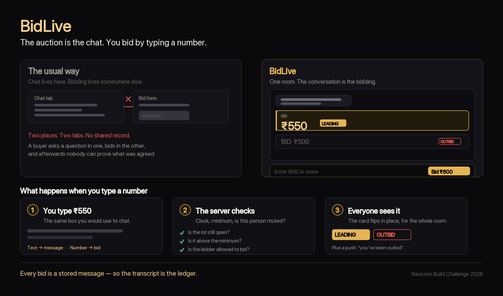

# BidLive — submission pack

Everything needed to fill the Nexconn Build Challenge 2026 submission form. Copy the sections below
into the write-up PDF (2 pages is plenty), and use the shot list to record the video.

---

## Form fields

| Field | Answer |
|---|---|
| Project name | **BidLive** |
| One-liner | A live auction that runs inside a chat room — bids are messages, the clock is enforced server-side, and the transcript is the ledger |
| App Key | `4z3hlwrv4jtkt` (production environment, North America data centre) |
| Demo video | `docs/video/bidlive-full.mp4` — 2:07, 1920×1080, narrated (`npm run video`). Upload unlisted and paste the link |
| Transcript | `docs/video/transcript.md` · narration only in `docs/video/voiceover.txt` |
| Runnable app | `<link>` |
| Public repo | https://github.com/devbulchandani/bidlive |
| Team | `<names + roles>` |
| Pre-existing code | **None — built from scratch during the challenge.** Seeded demo lots only |
| Category | Marketplace (also fits workplace/community chat) |

> The checklist requires the **App Key** in the PDF. The **App Secret** must never appear in the PDF,
> the video, the repo, or a screenshot. Keep it in `.env.local`, which is gitignored.

---



## 1. Problem

A collector in Jaipur misses the winning bid because he was driving. A seller can't prove what the
final price was. A buyer and seller argue over what was agreed, and the "chat" is in a different app
from the "auction".

Live auctions are social events — the condition question, the provenance photo, the "going once" —
but every platform splits the conversation from the bidding. That split costs conversions and leaves
no record when a dispute starts.

## 2. What we built

BidLive is a live auction where **the room is the auction**. One composer does both jobs: type text
and you're chatting; type a number at or above the minimum and the send button becomes the bid.

Around it sits the part that makes it usable rather than novel: a persistent rail of every auction
you are in, each row carrying its own live countdown and a category icon, so switching lots never
means switching tabs. Lots are shown with real photography and product-shot framing rather than
placeholders.

## 3. The mechanic

> **A bid is only valid if the auctioneer's clock and the minimum increment say so — and the room's
> message history is the ledger.**

Every bid is a custom message in the lot's Nexconn group channel. The server is the only writer, so
no client can win by having a faster machine, a wrong clock, or a patched UI.

## 4. How it works

```
browser ──SSE──────────► route handlers ──────────────► Nexconn Server API
   │                     (single writer)                 (group channel per lot)
   │                        ├─ pure rules (auction.ts)
   │                        ├─ append-only event log (store.ts)
   │                        └─ placeBid / recall / moderate / settle (service.ts)
   └──Chat SDK────────────► connect · join · receive ───► same channel
```

Decisions worth defending in the PDF:

- **Monotonic `seq` per lot.** Clients render by sequence, not arrival time. Two bids in the same
  millisecond resolve deterministically, and a client that reconnects can detect the gap and resync.
- **Server clock.** `serverTime` rides along with every push; clients correct their offset. A device
  with the wrong time still sees the right countdown.
- **Anti-snipe that is visible.** A bid in the final 30s extends the lot by 30s (max five) and the
  extension appears as a message in the room — not as a silently changing number.
- **Lead recomputed from the log.** Recall a bid and the leader is recalculated by replaying the
  transcript, so the projection can never drift from the history.
- **Lazy settlement.** Any read after `endsAt` settles the lot, which works on a platform with no
  long-running timers.
- **One rules module, two entry points.** The same `validateBid` powers the live API and the
  pre-delivery Nexconn callback, so the two paths cannot diverge.

## 5. Nexconn features used — and why

| Feature | What it bought us | Why a plain WebSocket couldn't |
|---|---|---|
| Group channel per lot | Durable, ordered, offline-safe room per lot | We'd have to build presence, sync, retention, push |
| Custom messages | Bid cards, extensions and settlements as structured content, not strings | Client-side parsing hacks |
| Server API (App Secret server-side) | Authoritative writes as the actual bidder | Client secrets or a fake bot identity |
| Chat SDK (web) | Client connects, joins, receives live, tracks connection state | A socket we'd have to keep alive ourselves |
| Push + private messages | "You've been outbid" reaches you when the tab is closed | Polling |
| Moderation (mute list) | A shill bidder is silenced and their bids are visibly refused | Trusting the client to behave |
| Pre-message callback (optional) | A rejected bid never reaches anyone | Post-hoc deletion, which is worse |
| 180-day history | The audit trail an auction dispute needs | Our own database |

## 5a. Persistence — the transcript *is* the database

There is no database in this project. The server keeps a projection in memory; the durable
record is the lot's Nexconn channel. On a cold start the room reads its own history back
through the SDK and replays it: bids are re-validated, sequence numbers re-issued, and the
current round located by the last settlement (or the first bid that breaks the rule that bids
must rise). Anything the auction engine would have refused is dropped.

This is the claim in section 3 made literal, and it answers the first question a judge asks
about a demo like this — "what happens when you restart it?"

## 6. Security

The App Secret exists only on the server. The browser receives a **user token**, issued by
`/api/token` after it has an identity, and nothing else. There is no code path that can publish a
message without server validation.

## 7. Limitations (state them — it reads as seniority)

- No payments; the settlement card is a handshake, not a transaction.
- Identity is a display name, not authentication.
- Single-instance state: auction state lives in process memory, so a serverless deploy would lose
  bids. Redis is the swap.
- Reserve is enforced at settlement, not revealed during bidding.

## 8. Next

Flip on the pre-delivery callback so invalid bids never exist, then add proxy bidding (a maximum the
server bids on your behalf, one increment at a time) — the same event log makes it a projection, not
a new subsystem.

---

## Demo video — 75 seconds, shot by shot

Record two browser windows side by side (1440 wide each) plus a phone for the notification beat.
Reset with the footer **Reset demo** button first, so the clock is fresh.

| Time | Shot | Say |
|---|---|---|
| 0–8s | Lobby. Point at the countdowns | "Three lots, live. No bid button anywhere." |
| 8–20s | Enter Lot 1 as Riya. Type `500`. Send button becomes **Bid ₹500** | "The composer is the bid." |
| 20–32s | Switch to Arjun's window, bid `550`. Cut back: Riya's card flips to **OUTBID** | "His card doesn't disappear — it flips, in place, in the history." |
| 32–45s | Cut to the phone, **screen locked**: "You've been outbid — ₹550 by Arjun." Tap → deep-links into the room | "This is a push, not a poll." |
| 45–55s | Arjun fat-fingers `6000` → recall → the lead recomputes to Riya at 620 | "The leader is recomputed from the message log." |
| 55–66s | Clock hits 0:29. Bid lands → **"Bid in the final 30 seconds — the clock extends"** card | "Anti-snipe is a rule you can read in the transcript." |
| 66–75s | Hammer. SOLD card: Riya ₹620. Panel shows `sold` | "Every bid is a Nexconn message. The transcript is the ledger." |

If the SDK/push isn't configured on the recording machine, say so out loud and show the local bus
badge. Judges forgive an honest fallback; they don't forgive a fake one.

## Judges' questions to have answers for

- **"What stops a client from sending a fake bid?"** Nothing reaches the channel except through the
  server's validator; the client never publishes directly.
- **"Two people bid at once?"** Mono `seq` from the event log; last accepted sequence wins.
- **"Why is this a chat product?"** Remove the room and there is no auction — no audience, no
  provenance questions, no record. The mechanic is the conversation.
- **"What would break at scale?"** In-memory store and single-process SSE. Redis plus pub/sub is the
  swap; the event log design already assumes replay.
